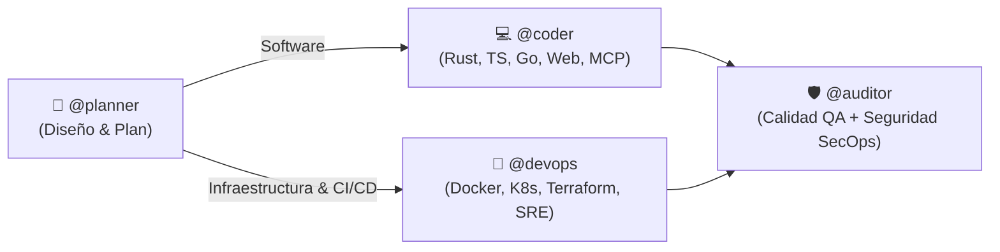

# agents.conf — Universal & Agnostic AI Agent Operating Configuration

> **Repositorio agnóstico de configuración, guardrails y orquestación multi-agente** para **Antigravity (AGY)**, **GitHub Copilot**, **Cursor**, **Windsurf**, **Claude Code** y cualquier agente de IA compatible.

---

## 🎯 Objetivo y Filosofía Agnóstica

Cualquier agente de IA o desarrollador que clone o abra este repositorio sabe exactamente cómo operar de forma nativa e inmediata, sin requerir configuraciones previas ni rutas absolutas acopladas al host.

### Matriz de Compatibilidad Nativa

| Entorno / Asistente | Archivo de Entrada Nativo | Propósito |
| :--- | :--- | :--- |
| **Estándar Universal** | [`AGENTS.md`](AGENTS.md) | Especificación canónica transversal para cualquier LLM/agente |
| **Antigravity / Gemini CLI** | [`GEMINI.md`](GEMINI.md), [`config.json`](config.json), [`rules/`](rules/), [`skills/`](skills/) | Sistema nativo de reglas, skills, imports y statusline |
| **Claude / Claude Code** | [`CLAUDE.md`](CLAUDE.md) | Instrucciones automáticas y directivas de ejecución |
| **Cursor IDE** | [`.cursorrules`](.cursorrules), [`.cursor/rules/`](.cursor/rules/) | Reglas contextuales globales y archivos `.mdc` |
| **Windsurf** | [`.windsurfrules`](.windsurfrules) | Directivas operativas para el motor Cascade |
| **GitHub Copilot** | [`.github/copilot-instructions.md`](.github/copilot-instructions.md) | Instrucciones de workspace para Copilot Chat y CLI |

---

## 🏛️ Arquitectura: Router de 4 Agentes Especializados

El sistema organiza las suites de capacidades técnicas en 4 agentes de primer nivel accesibles mediante menciones o contexto:



| Agente | Tag | Skills Asociadas | Sub-personas (`skills/*/references/`) | Misión Central |
| :--- | :--- | :--- | :--- | :--- |
| **Architect Planner** | `@planner` | `architecture-planning`, `ponytail-audit`, `ponytail-debt` | `master-plan-architect`, `backend-architect`, `api-platform-engineer`, `software-architect` | **ZERO CODE EXECUTION**. Arquitectura técnica, planes paso a paso, contratos OpenAPI/gRPC y Red Teaming en Markdown. Pausa obligatoria para aprobación humana. |
| **Polyglot Coder** | `@coder` | `languages-code`, `ponytail` | `rust-refactoring-specialist`, `frontend-developer`, `mcp-builder`, `webassembly-engineer` | Implementación quirúrgica con diffs mínimos en Rust, TS, Go, Wasm y MCP. Aplica Ponytail (`lite`, `full`, `ultra`). |
| **Platform DevOps** | `@devops` | `platform-devops`, `ponytail` | `devops-automator`, `platform-engineer`, `sre-site-reliability-engineer`, `database-reliability-engineer`, `finops-engineer` | Infraestructura reproducible: Dockerfiles, K8s manifests, GitHub Actions, HA DB y FinOps sin sobre-ingeniería. |
| **Security & QA Auditor** | `@auditor` | `review-quality`, `security-audit`, `ponytail-review` | `code-reviewer`, `minimal-change-engineer`, `test-automation-engineer`, `cloud-security-architect`, `application-security-engineer`, `penetration-tester` | Puerta integral de calidad y seguridad. `ponytail-review` (Must fix, Should fix, Nice to have), Zero Trust, AppSec OWASP. |

---

## 🛡️ Sidecar Laya: Guardrails de Seguridad en Tiempo Real (<2ms)

El repositorio incluye en [`sidecars/laya/`](sidecars/laya/) el motor determinista de guardrails no autorregresivo:
- **Intercepción Zero-Latency (`<2ms`)**: Evalúa comandos antes de su ejecución mediante hooks de `PreToolUse`.
- **Bloqueo Determinista (`BLOCK`)**: Comandos críticos (`rm -rf /`, `DROP DATABASE`, `mkfs`, eliminaciones masivas) son bloqueados de raíz antes de que el subshell los reciba.
- **Solicitud de Confirmación (`CONFIRM`)**: Operaciones de riesgo (`git push --force`, `git reset --hard`) requieren aprobación explícita.
- **Detección de Secretos**: Escaneo de variables y claves API en payloads de comandos.

---

## 🧠 Protocolo de Comunicación (ADHD Output Style)

1. **Directo a la acción:** Comando, ruta o snippet primero.
2. **Tareas acotadas:** Pasos numerados con una sola acción por paso.
3. **Cierre inmediato:** Terminar con una siguiente acción realizable en menos de 2 minutos.
4. **Foco:** Resolver el problema actual antes de abrir uno nuevo.
5. **Progreso visible:** Indicar avance en cada turno ("paso 3 de 5 completado").
6. **Tiempos exactos:** Estimaciones en unidades reales (ej. "30 segundos", "5 minutos").
7. **Verificación:** Mostrar qué funciona tras cada modificación.
8. **Errores sin rodeos:** Ubicación, causa raíz y solución.
9. **Límite de 5:** Listas con un máximo de 5 puntos.
10. **Cero relleno:** Sin preámbulos, despedidas ni resúmenes redundantes.

---

## ⚡ Estándares CLI de Alto Rendimiento

Se prohíbe el uso de comandos lentos POSIX tradicionales en tareas automatizadas:

| Comando Legacy | Reemplazo Moderno | Comando / Flags Requeridos |
| :--- | :--- | :--- |
| `grep` | `rg` (ripgrep) | `rg --color=never --no-heading -n --smart-case --max-columns=500` |
| `find` | `fd` (fd-find) | `fd --color=never -H -I --type f` |
| `cat` | `bat` | `bat -pp --color=never` *(siempre `-pp` para evitar bloqueos por paginador)* |
| `ls` | `eza` / `fd -d 1` | `eza -1 -a --no-quotes --color=never` *(fallback: `fd -d 1 -l -H .`)* |
| `sed` | `sd` | `sd -s "$FIND" "$REPLACE" "$FILE"` |
| `ps` | `procs` | `procs --color=never --pager=disable` |
| `du` | `dust` | `dust -c -b -d 2` |
| `df` | `duf` | `duf --style=plain` |

---

## 📂 Estructura del Repositorio

```text
.
├── AGENTS.md                  # Especificación unificada para cualquier agente de IA
├── CLAUDE.md                  # Entrada nativa para Claude Code
├── GEMINI.md                  # Entrada nativa para Antigravity / Gemini CLI
├── README.md                  # Documentación global del framework
├── .cursorrules               # Entrada nativa para Cursor
├── .cursor/rules/             # Reglas modulares .mdc para Cursor
├── .github/                   # Instrucciones para GitHub Copilot y CI
│   ├── copilot-instructions.md
│   └── workflows/validate-config.yml
├── .windsurfrules              # Entrada nativa para Windsurf
├── bin/
│   ├── agents-conf            # CLI universal de orquestación, symlinks y sync
│   └── agy-conf               # Alias retrocompatible
├── config.json                # Configuración base de políticas y presets
├── install.sh                 # Script instalador/sincronizador universal
├── rules/                     # Reglas canónicas del sistema
│   ├── agent-personas.md
│   ├── governance.md
│   ├── i-have-adhd.md
│   ├── it-agents-directory.md
│   ├── modern-cli-tooling.md
│   └── projects-layout.md
├── sidecars/
│   └── laya/                  # Sidecar de guardrails, router y escáner (<2ms)
│       ├── bin/laya-hook      # Launcher portable de hooks
│       ├── hooks/native_hook.py
│       └── src/laya_agy_sidecar/
├── skills/                    # Suites completas de habilidades y referencias
│   ├── architecture-planning/
│   ├── languages-code/
│   ├── platform-devops/
│   ├── review-quality/
│   ├── security-audit/
│   ├── i-have-adhd/
│   └── ponytail*/
└── scripts/                   # Scripts auxiliares
    └── agy_statusline.py      # Statusline Python con tokens, contexto y cuotas
```

---

## 🚀 Guía de Puesta en Marcha Rápida (Cualquier PC)

### Paso 1: Instalación inicial (Una sola vez por máquina — 30 seg)
Ejecuta en tu terminal (Linux, macOS o WSL):
```bash
git clone https://github.com/jwyx1/agents.conf.git ~/.config/agents.conf
cd ~/.config/agents.conf
./install.sh
```
*¿Qué hace automáticamente?*
- Enlaza en vivo las directivas globales (`~/.gemini/`, `~/.claude/CLAUDE.md`, `~/.config/AGENTS.md`).
- Instala los comandos globales `agents-conf` y `agy-conf` en `~/.local/bin/`.
- Configura el interceptor de seguridad Laya en `~/.gemini/config/hooks.json`.

---

### Paso 2: Cómo usarlo según el agente que abras

#### 🧠 1. Con Claude Code (CLI)
No necesitas configurar nada adicional dentro de tus proyectos.
1. Abre tu terminal en la carpeta de cualquier proyecto:
   ```bash
   cd ~/mi-proyecto
   claude
   ```
2. Claude Code detecta automáticamente `~/.claude/CLAUDE.md` a nivel global y operará con el estilo ADHD y el router `@planner` / `@coder` sin configuraciones locales.

#### 🐙 2. Con GitHub Copilot (VS Code / JetBrains)
Para que Copilot Chat y sus asistentes apliquen las directivas en un proyecto concreto:
1. Abre la terminal dentro de la raíz del proyecto.
2. Ejecuta:
   ```bash
   agents-conf inject .
   ```
3. Esto crea `.github/copilot-instructions.md` enlazado a `agents.conf`. Copilot aplicará de inmediato el protocolo de respuestas y directivas.

#### 🤖 3. Con Antigravity (`agy` CLI)
1. Ejecuta `agy` desde cualquier directorio:
   ```bash
   agy
   ```
2. Tu terminal cargará automáticamente:
   - Statusline con métricas de tokens y cuotas (`scripts/agy_statusline.py`).
   - Guardrails Laya bloqueando acciones destructivas en <2 ms (`sidecars/laya`).
   - Todas las reglas y router de 4 agentes (`rules/` y `skills/`).

#### 💻 4. Con Cursor IDE
- **En cualquier proyecto**: Ejecuta `agents-conf inject .` en la raíz del proyecto. Cursor leerá `.cursorrules` y aplicará las directivas en cada prompt.
- **Directo en agents.conf**: Si abres la carpeta de `agents.conf` en Cursor, este carga automáticamente `.cursor/rules/*.mdc`.

#### 🌊 5. Con Windsurf (Cascade)
1. En la raíz de tu proyecto, corre:
   ```bash
   agents-conf inject .
   ```
2. Windsurf cargará `.windsurfrules` y Cascade adoptará el comportamiento y las restricciones de gobernanza del sistema.

---

### Paso 3: Sincronización diaria (Trabajo ↔ Casa)

Cualquier edición que hagas en reglas, skills o prompts desde cualquier editor modifica directamente los archivos del repositorio gracias a los symlinks vivos.

- **Al terminar de trabajar (en la oficina o en casa):**
  ```bash
  agents-conf sync "feat: ajuste en reglas de claude y copilot"
  ```
- **Al comenzar el día en la otra máquina:**
  ```bash
  agents-conf sync
  ```
  *(Descarga los cambios de GitHub mediante `pull --rebase` y deja tu entorno 100% sincronizado).*

