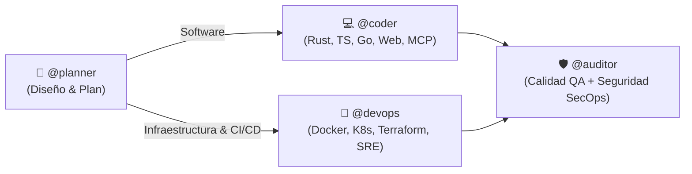

# agy.conf — Universal & Agnostic AI Agent Operating Configuration

> **Repositorio agnóstico de configuración y orquestación multi-agente** para **Antigravity (AGY)**, **GitHub Copilot**, **Cursor**, **Windsurf**, **Claude Code** y cualquier agente de IA compatible.

---

## 🎯 Objetivo y Filosofía Agnóstica

Cualquier agente de IA o desarrollador que clone o abra este repositorio sabe exactamente cómo operar de forma nativa e inmediata, sin requerir configuraciones previas ni rutas absolutas acopladas al host.

### Matriz de Compatibilidad Nativa

| Entorno / Asistente | Archivo de Entrada Nativo | Propósito |
| :--- | :--- | :--- |
| **Estándar Universal** | [`AGENTS.md`](AGENTS.md) | Especificación canónica transversal para cualquier LLM/agente |
| **Antigravity / Gemini CLI** | [`GEMINI.md`](GEMINI.md), [`config.json`](config.json), [`rules/`](rules/), [`skills/`](skills/) | Sistema nativo de reglas, skills, imports y statusline |
| **Claude / Claude Code** | [`CLAUDE.md`](CLAUDE.md) | Instrucciones automáticas y directivas de ejecución |
| **Cursor IDE** | [`.cursorrules`](.cursorrules), [`.cursor/rules/`](.cursor/rules/) | Reglas contextuales globales y archivos `.mdc` |
| **Windsurf** | [`.windsurfrules`](.windsurfrules) | Directivas operativas para el motor Cascade |
| **GitHub Copilot** | [`.github/copilot-instructions.md`](.github/copilot-instructions.md) | Instrucciones de workspace para Copilot Chat y CLI |

---

## 🏛️ Arquitectura: Router de 4 Agentes Especializados

El sistema organiza las suites de capacidades técnicas en 4 agentes de primer nivel accesibles mediante menciones o contexto:



| Agente | Tag | Skills Asociadas | Sub-personas (`skills/*/references/`) | Misión Central |
| :--- | :--- | :--- | :--- | :--- |
| **Architect Planner** | `@planner` | `architecture-planning`, `ponytail-audit`, `ponytail-debt` | `master-plan-architect`, `backend-architect`, `api-platform-engineer`, `software-architect` | **ZERO CODE EXECUTION**. Arquitectura técnica, planes paso a paso, contratos OpenAPI/gRPC y Red Teaming en Markdown. Pausa obligatoria para aprobación humana. |
| **Polyglot Coder** | `@coder` | `languages-code`, `ponytail` | `rust-refactoring-specialist`, `frontend-developer`, `mcp-builder`, `webassembly-engineer` | Implementación quirúrgica con diffs mínimos en Rust, TS, Go, Wasm y MCP. Aplica Ponytail (`lite`, `full`, `ultra`). |
| **Platform DevOps** | `@devops` | `platform-devops`, `ponytail` | `devops-automator`, `platform-engineer`, `sre-site-reliability-engineer`, `database-reliability-engineer`, `finops-engineer` | Infraestructura reproducible: Dockerfiles, K8s manifests, GitHub Actions, HA DB y FinOps sin sobre-ingeniería. |
| **Security & QA Auditor** | `@auditor` | `review-quality`, `security-audit`, `ponytail-review` | `code-reviewer`, `minimal-change-engineer`, `test-automation-engineer`, `cloud-security-architect`, `application-security-engineer`, `penetration-tester` | Puerta integral de calidad y seguridad. `ponytail-review` (Must fix, Should fix, Nice to have), Zero Trust, AppSec OWASP. |

---

## 🧠 Protocolo de Comunicación (ADHD Output Style)

1. **Directo a la acción:** Comando, ruta o snippet primero.
2. **Tareas acotadas:** Pasos numerados con una sola acción por paso.
3. **Cierre inmediato:** Terminar con una siguiente acción realizable en menos de 2 minutos.
4. **Foco:** Resolver el problema actual antes de abrir uno nuevo.
5. **Progreso visible:** Indicar avance en cada turno ("paso 3 de 5 completado").
6. **Tiempos exactos:** Estimaciones en unidades reales (ej. "30 segundos", "5 minutos").
7. **Verificación:** Mostrar qué funciona tras cada modificación.
8. **Errores sin rodeos:** Ubicación, causa raíz y solución.
9. **Límite de 5:** Listas con un máximo de 5 puntos.
10. **Cero relleno:** Sin preámbulos, despedidas ni resúmenes redundantes.

---

## ⚡ Estándares CLI de Alto Rendimiento

Se prohíbe el uso de comandos lentos POSIX tradicionales en tareas automatizadas:

| Comando Legacy | Reemplazo Moderno | Comando / Flags Requeridos |
| :--- | :--- | :--- |
| `grep` | `rg` (ripgrep) | `rg --color=never --no-heading -n --smart-case --max-columns=500` |
| `find` | `fd` (fd-find) | `fd --color=never -H -I --type f` |
| `cat` | `bat` | `bat -pp --color=never` *(siempre `-pp` para evitar bloqueos por paginador)* |
| `ls` | `eza` / `fd -d 1` | `eza -1 -a --no-quotes --color=never` *(fallback: `fd -d 1 -l -H .`)* |
| `sed` | `sd` | `sd -s "$FIND" "$REPLACE" "$FILE"` |
| `ps` | `procs` | `procs --color=never --pager=disable` |
| `du` | `dust` | `dust -c -b -d 2` |
| `df` | `duf` | `duf --style=plain` |

---

## 📂 Estructura del Repositorio

```text
.
├── AGENTS.md                  # Especificación unificada para cualquier agente de IA
├── CLAUDE.md                  # Entrada nativa para Claude Code
├── GEMINI.md                  # Entrada nativa para Antigravity / Gemini CLI
├── README.md                  # Documentación global del framework
├── .cursorrules               # Entrada nativa para Cursor
├── .cursor/rules/             # Reglas modulares .mdc para Cursor
├── .github/                   # Instrucciones para GitHub Copilot
│   └── copilot-instructions.md
├── .windsurfrules              # Entrada nativa para Windsurf
├── config.json                # Configuración base de políticas y presets
├── settings.json.example      # Plantilla para settings del CLI de Antigravity
├── hooks.json.example         # Plantilla portable de hooks pre-tool
├── import_manifest.json       # Manifiesto de imports y extensiones
├── mcp_config.json            # Configuración de servidores MCP
├── install.sh                 # Script instalador/sincronizador a ~/.gemini
├── rules/                     # Reglas canónicas del sistema
│   ├── agent-personas.md
│   ├── governance.md
│   ├── i-have-adhd.md
│   ├── it-agents-directory.md
│   ├── modern-cli-tooling.md
│   └── projects-layout.md
├── skills/                    # Suites completas de habilidades y referencias
│   ├── architecture-planning/
│   ├── languages-code/
│   ├── platform-devops/
│   ├── review-quality/
│   ├── security-audit/
│   ├── i-have-adhd/
│   └── ponytail*/
└── scripts/                   # Scripts auxiliares
    └── agy_statusline.py      # Statusline Python con tokens, contexto y cuotas
```

---

## 🚀 Instalación y Sincronización Rápida

Para sincronizar esta configuración en tu entorno local de **Antigravity** (`~/.gemini/`):

```bash
git clone https://github.com/jwyx1/agy.conf.git
cd agy.conf
./install.sh
```

El script copia y enlaza automáticamente las reglas, skills, scripts de statusline y configuraciones base, comprobando la presencia de las herramientas CLI modernas (`rg`, `fd`, `bat`, `eza`, etc.).
