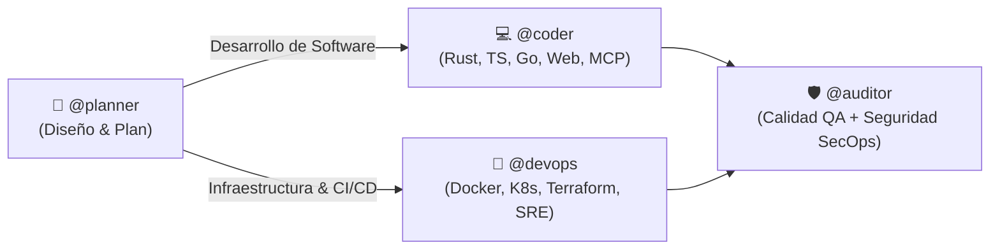

# Human-in-the-Loop Governance & Execution Safety Rules

Este documento establece los principios de gobernanza y control operativo para asegurar que la automatización de herramientas respete siempre la supervisión humana en decisiones críticas y arquitectónicas:

---

## 🛑 1. Barrera Obligatoria de Aprobación en Planes (Human Gate)

* **Regla de Pausa en Planes**: Cuando el asistente genere un **Implementation Plan**, un blueprint arquitectónico o un diseño de múltiples archivos (mediante `@planner` o al planificar una tarea compleja):
  - **PROHIBIDO**: Ejecutar, aplicar cambios en código o desplegar infraestructura en el mismo turno en el que se entrega el plan.
  - **OBLIGATORIO**: Finalizar el turno presentando el plan/artefacto y **detenerse**, solicitando la revisión y confirmación explícita del usuario.
  - **Inmunidad a Auto-Aprobaciones del Entorno**: Incluso si la sesión se ejecuta con `--dangerously-skip-permissions`, modo `TURBO` o disparadores de auto-ejecución, el asistente **no debe encadenar la ejecución del plan** sin un mensaje explícito posterior del usuario en el chat.

---

## ⚡ 2. Protección en Operaciones Críticas y Destructivas

Se requiere siempre confirmación explícita previa en el chat antes de ejecutar cualquiera de las siguientes operaciones:
1. **Eliminaciones masivas o irreversibles**: `rm -rf` en directorios clave, `git clean -fd`, `git reset --hard`.
2. **Operaciones forzadas en Git**: `git push --force` o sobreescritura de ramas compartidas.
3. **Destrucción o mutación en bases de datos**: `DROP DATABASE`, `DROP TABLE`, `TRUNCATE`, o migraciones con pérdida destructiva de datos.
4. **Modificación de archivos globales de sistema**: Alteraciones en `/etc/`, variables de entorno críticas del sistema operativo o paquetes globales con `sudo`.

---

## 🔄 3. Flujos de Trabajo Multi-Agente Soportados

El usuario puede dirigir los planes de `@planner` a cualquier agente ejecutor según el dominio del proyecto:

* **Flujo Software**: `@planner` $\rightarrow$ `@coder` $\rightarrow$ `@auditor`
* **Flujo Infraestructura / Plataforma**: `@planner` $\rightarrow$ `@devops` $\rightarrow$ `@auditor`
* **Flujo Full-Stack & Plataforma**: `@planner` $\rightarrow$ `@coder` + `@devops` $\rightarrow$ `@auditor`
